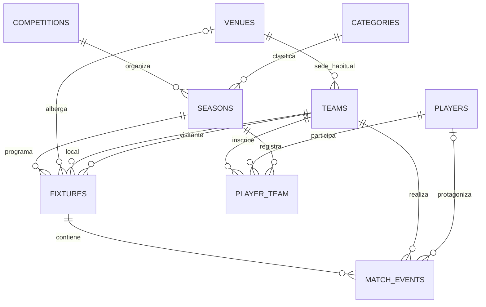

# Modelo entidad-relación de LigaHub

## Objetivo y alcance

El esquema separa los datos de competición, la temporada concreta, los equipos, los jugadores y los partidos. De este modo, la misma competición puede repetirse en distintas temporadas y un jugador puede cambiar de equipo conservando el histórico de sus inscripciones.

## Diagrama entidad-relación

El diagrama gráfico está disponible en [`modelo-base-datos.png`](modelo-base-datos.png) y en formato editable en [`modelo-base-datos.dot`](modelo-base-datos.dot).



## Entidades principales y justificación

- **competitions**: define una liga, copa o torneo. Se separa de `seasons` para poder reutilizar una competición en diferentes años.
- **categories**: define la división deportiva (por ejemplo, sénior o sub-18 y género). Una categoría puede usarse en muchas temporadas.
- **seasons**: vincula competición y categoría con fechas y estado. Es la unidad que agrupa calendario y plantillas.
- **venues**: almacena instalaciones deportivas y evita repetir sus datos en equipos y partidos.
- **teams**: representa a cada equipo participante; conserva su sede habitual y ciudad.
- **players**: guarda la identidad deportiva de cada jugador de forma independiente del equipo al que pertenezca en una temporada.
- **fixtures**: representa un partido con temporada, jornada, equipos local/visitante, fecha, sede, estado y marcador.
- **player_team**: tabla pivote entre `players` y `teams`; incorpora temporada, dorsal, posición, fecha de alta/baja y capitanía. Es una relación N:N con atributos propios.
- **match_events**: registra goles, tarjetas, asistencias y otros sucesos asociados a un partido; jugador puede ser nulo para sucesos no atribuidos individualmente.
- **users**: tabla estándar de Laravel para las cuentas de acceso. La autorización y los roles se desarrollarán en el sprint correspondiente.

## Relaciones

- Una competición tiene muchas temporadas; cada temporada pertenece a una competición y a una categoría.
- Una temporada tiene muchos partidos y muchas inscripciones de plantilla.
- Un equipo puede tener muchos jugadores y un jugador puede pertenecer a distintos equipos a lo largo del tiempo. `player_team` guarda el contexto de cada inscripción.
- Un equipo puede ser local o visitante en muchos partidos. Los dos roles usan claves foráneas independientes (`home_team_id` y `away_team_id`).
- Un partido tiene muchos eventos. Cada evento pertenece a un equipo y puede referenciar un jugador.
- Una sede puede ser la sede habitual de varios equipos y albergar varios partidos.

## Restricciones e índices

- `slug` es único en competiciones, categorías y equipos.
- Una temporada no puede repetir el mismo nombre dentro de una combinación de competición y categoría.
- Un partido no puede repetir la misma combinación de temporada, jornada, local y visitante.
- Un equipo no puede jugar contra sí mismo (`home_team_id <> away_team_id`).
- El marcador debe estar completamente vacío o contener ambos resultados.
- Un jugador solo puede estar inscrito en un equipo por temporada.
- El dorsal es único dentro de un equipo y temporada.
- Las claves foráneas definen el comportamiento de borrado; las entidades históricas usan borrado lógico.
- Hay índices para estados, fechas, ciudad, jornada, nombres y tipos de evento, que apoyan las consultas frecuentes.

## Borrado lógico

Se aplica `SoftDeletes` a competiciones, categorías, temporadas, sedes, equipos, jugadores y partidos. Así pueden conservarse registros históricos sin borrarlos físicamente. Las inscripciones de plantilla y los eventos no usan borrado lógico en esta fase; forman parte de relaciones históricas concretas.

## Datos de prueba reproducibles

`DatabaseSeeder` fija una semilla de Faker (`20261014`) y crea un conjunto estable: usuario de prueba, competición, categoría, temporada, cuatro sedes/equipos, 24 jugadores, inscripciones, cuatro partidos y tres eventos. El objetivo es poder repetir las pruebas con los mismos datos base.

## Comandos de comprobación

Ejecutar desde la raíz del proyecto. `migrate:fresh` elimina las tablas de la base de datos configurada.

```bash
php artisan migrate:fresh --seed
php artisan test
```
